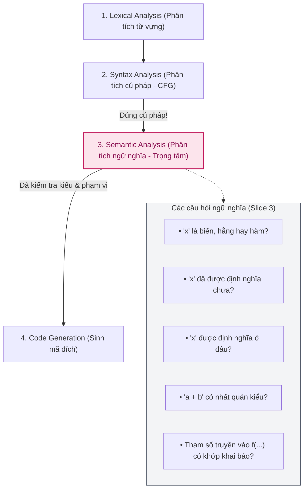
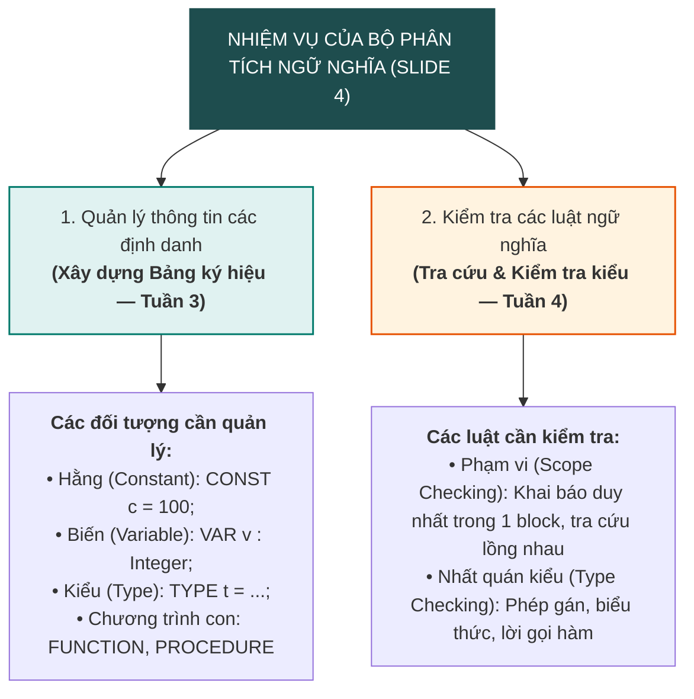
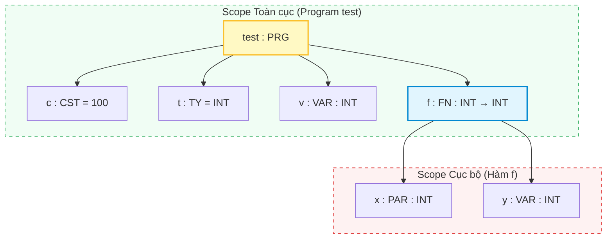
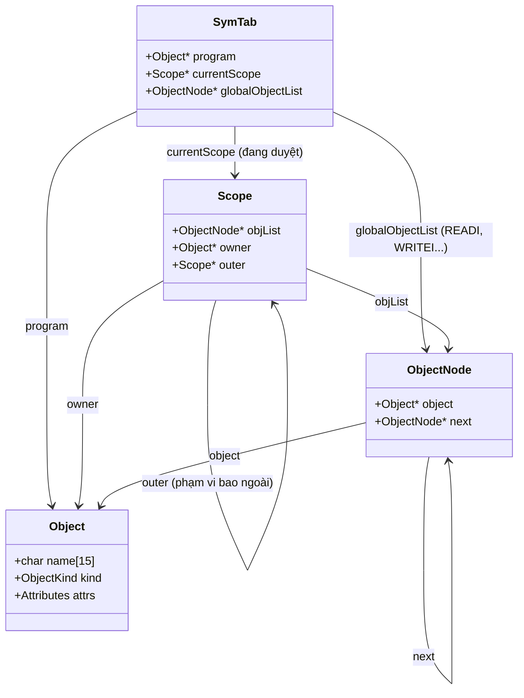
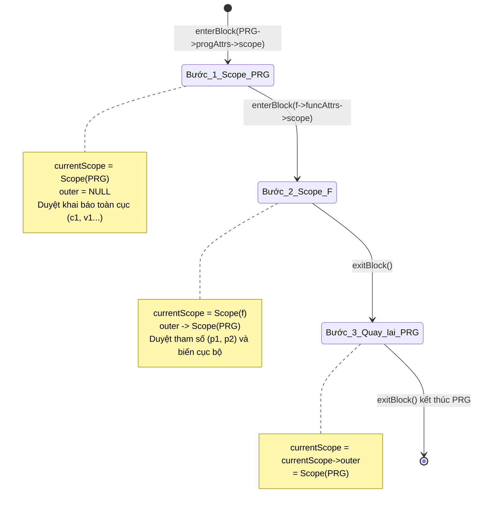
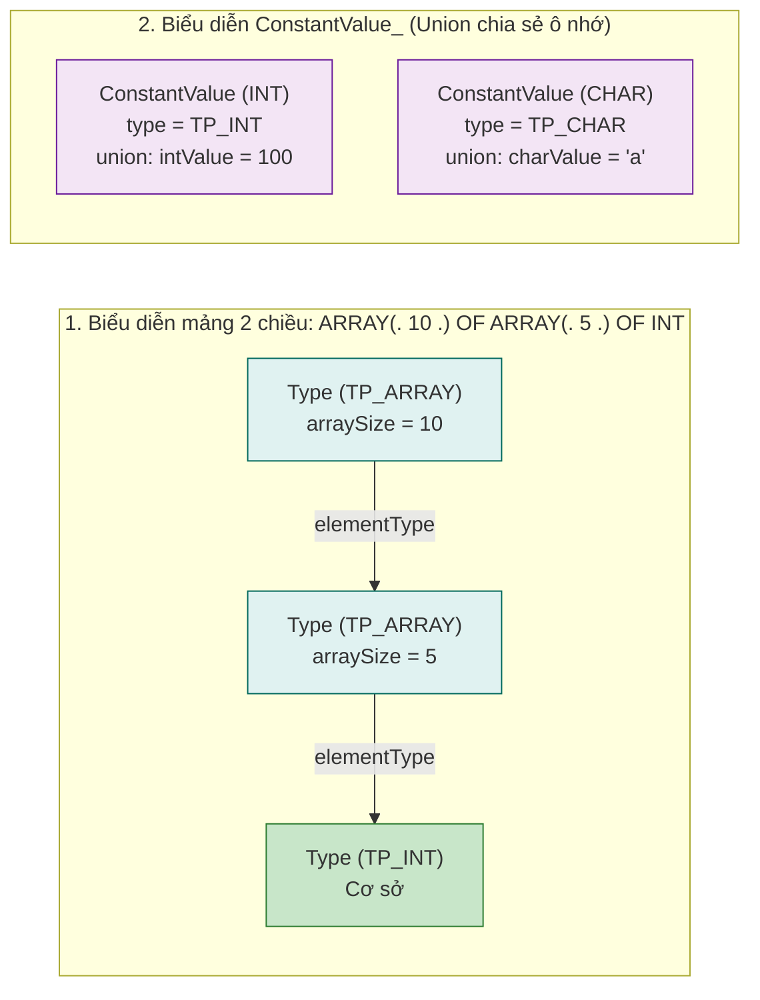
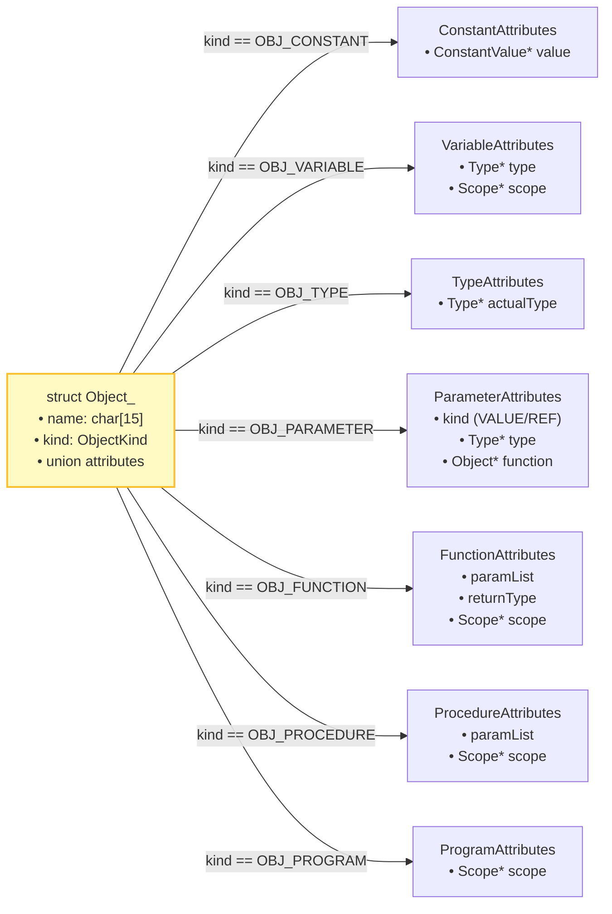
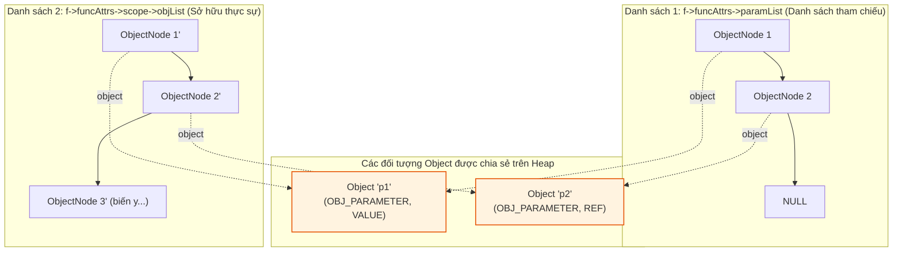
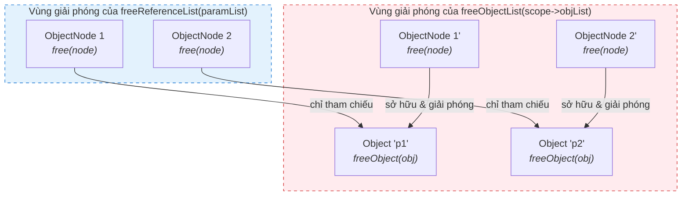

> [!NOTE]
> **Thông tin Nguồn gốc và Ghi công Tài liệu (Document Attribution)**
> - **Đơn vị biên soạn tài liệu:** Hướng dẫn chi tiết, hệ thống sơ đồ trực quan và lời giải mẫu bằng ngôn ngữ C được biên soạn để hỗ trợ sinh viên học phần Chương trình dịch (IT3323).
> - **Tài liệu gốc làm cơ sở:** Biên soạn trực tiếp dựa trên bộ Slides bài giảng *"Experiment in Compiler Construction -- Phân tích ngữ nghĩa (1)"* (`l4-semantics-analysis-1.pdf`, gồm 18 trang) và bộ mã nguồn khung trình biên dịch ngôn ngữ **KPL**.
> - **Tác giả bài giảng gốc và mã nguồn khung:** **TS. Nguyễn Hữu Đức** — *Bộ môn Hệ thống thông tin, Khoa Công nghệ Thông tin, Trường Đại học Bách khoa Hà Nội*.
> - **Định dạng hiển thị:** Định dạng chuẩn theo GitHub-Flavored Markdown (GFM), hiển thị tối ưu trên GitHub và VS Code Markdown Preview với biểu đồ **Mermaid** tích hợp.

---

# 1. Tổng quan về Phân tích Ngữ nghĩa (Semantic Analysis)

*Nội dung chương này được biên soạn dựa trên **Slide 2, Slide 3 và Slide 4** trong bài giảng của **TS. Nguyễn Hữu Đức**.*

## 1.1. Vị trí và vai trò của Phân tích Ngữ nghĩa trong Trình biên dịch

Trong kiến trúc kinh điển của một trình biên dịch (Compiler), quá trình dịch một chương trình nguồn sang mã máy đích đi qua bốn pha nối tiếp nhau:

1. **Phân tích từ vựng (Lexical Analysis / Scanner):** Đọc dòng ký tự nguồn và gom nhóm chúng thành các đơn vị từ vựng hợp lệ gọi là *Token* (từ khóa, định danh, hằng số, toán tử...).
2. **Phân tích cú pháp (Syntax Analysis / Parser):** Kiểm tra xem chuỗi các Token có tuân theo các quy tắc cấu trúc ngữ pháp phi ngữ cảnh (*Context-Free Grammar — CFG*) của ngôn ngữ lập trình hay không.
3. **Phân tích ngữ nghĩa (Semantic Analysis):** Kiểm tra tính hợp lệ về mặt **ý nghĩa logic và ngữ cảnh** của chương trình dựa trên các khai báo định danh và hệ thống kiểu dữ liệu.
4. **Sinh mã (Code Generation):** Chuyển đổi chương trình đã được kiểm chứng sang mã máy ảo hoặc hợp ngữ đích.

### Tại sao chỉ Phân tích Cú pháp là chưa đủ?

Bộ phân tích cú pháp (như chúng ta đã xây dựng ở Tuần 2) chỉ quan tâm đến **hình thức câu lệnh** (ví dụ: một phép gán có dạng `Biến := Biểu_thức;`, một lời gọi hàm có dạng `Tên_hàm(Danh_sách_đối_số)`). Tuy nhiên, văn phạm phi ngữ cảnh hoàn toàn **không thể trả lời** các câu hỏi phụ thuộc vào ngữ cảnh khai báo trước đó (Slide 3):

- **`"x"` là tên một biến hay một hàm?** (Nếu `"x"` là tên một thủ tục, ta không thể viết `x := 10;` dù câu lệnh đó đúng cú pháp phép gán!).
- **`"x"` đã được định nghĩa (khai báo) trước khi sử dụng hay chưa?**
- **`"x"` được định nghĩa ở đâu?** (Nằm ở phạm vi toàn cục của chương trình chính hay phạm vi cục bộ của một hàm con? Nếu có nhiều định danh cùng tên `"x"` ở các phạm vi lồng nhau thì câu lệnh hiện tại đang tham chiếu tới `"x"` nào?).
- **Biểu thức `"a + b"` có kiểu dữ liệu nhất quán không?** (Ví dụ: `"a"` là kiểu số nguyên `INTEGER` còn `"b"` lại là một mảng `ARRAY` hoặc hằng ký tự `CHAR` thì phép cộng có hợp lệ không?).

Bộ **Phân tích ngữ nghĩa** ra đời chính là để trả lời toàn bộ các câu hỏi trên, làm sáng tỏ ngữ nghĩa của chương trình và chặn đứng các lỗi logic tĩnh trước khi bước sang pha sinh mã.

---

## 1.2. Đối chiếu Mã nguồn Lỗi Ngữ nghĩa và Sơ đồ Kiến trúc (Slide 3)

Để thấy rõ ranh giới giữa **Cú pháp (Syntax)** và **Ngữ nghĩa (Semantics)**, hãy quan sát đoạn chương trình KPL dưới đây (vượt qua hoàn toàn bộ Parser ở Tuần 2 nhưng chứa 4 lỗi ngữ nghĩa nghiêm trọng):

```pascal
PROGRAM DemoSemanticErrors;
CONST c = 100;
TYPE  ArrType = ARRAY(. 5 .) OF INTEGER;
VAR   a : INTEGER;
      b : ArrType;

FUNCTION f(x : INTEGER) : INTEGER;
BEGIN
  f := x + 1;
END;

BEGIN
  (* Lỗi 1: 'z' chưa hề được khai báo! *)
  z := 10;

  (* Lỗi 2: 'c' là hằng số, không thể
     đứng ở vế trái của phép gán! *)
  c := 200;

  (* Lỗi 3: Biểu thức 'a + b' không nhất
     quán kiểu (INTEGER + ARRAY)! *)
  a := a + b;

  (* Lỗi 4: Hàm 'f' cần 1 tham số nhưng
     lời gọi hàm lại truyền 2 đối số! *)
  a := f(10, 20);
END.
```

### Sơ đồ vị trí của Phân tích Ngữ nghĩa và Các câu hỏi cốt lõi



---

## 1.3. Hai nhiệm vụ cốt lõi của Bộ Phân tích Ngữ nghĩa (Slide 4)

Theo **Slide 4** của TS. Nguyễn Hữu Đức, một bộ phân tích ngữ nghĩa trong trình biên dịch KPL đảm nhận hai nhóm nhiệm vụ chính có quan hệ mật thiết với nhau:

1. **Quản lý thông tin về các định danh (Identifier Management):**
   Thu thập, phân loại và lưu trữ thông tin chi tiết vào **Bảng ký hiệu (Symbol Table)** mỗi khi trình biên dịch duyệt qua phần khai báo của:
   - **Hằng (`Constant`):** Tên hằng, kiểu dữ liệu (`INT` hoặc `CHAR`), và giá trị cụ thể.
   - **Biến (`Variable`):** Tên biến, kiểu dữ liệu (nguyên, ký tự, hoặc mảng nhiều chiều), và phạm vi chứa biến.
   - **Kiểu người dùng định nghĩa (`User-defined Type`):** Tên kiểu mới (alias) và cấu trúc kiểu thực tế (`actualType`).
   - **Chương trình con (`Subprograms` — Hàm `Function` và Thủ tục `Procedure`):** Tên chương trình con, danh sách các tham số hình thức, kiểu trả về (đối với hàm), và phạm vi cục bộ (`scope`) của chương trình con đó.

2. **Kiểm tra một số luật ngữ nghĩa (Semantic Rule Checking):**
   Khi duyệt tới thân chương trình (`BEGIN ... END`), bộ phân tích ngữ nghĩa tra cứu Bảng ký hiệu để kiểm tra:
   - **Phạm vi định danh (Scope Rules):** Kiểm tra lỗi khai báo trùng tên trong cùng một block, lỗi sử dụng định danh chưa khai báo, và xác định đúng đối tượng gần nhất theo luật phạm vi lồng nhau.
   - **Nhất quán kiểu (Type Consistency / Type Checking):** Kiểm tra sự tương thích kiểu giữa hai vế của phép gán, giữa các toán hạng trong biểu thức số học/so sánh, chỉ số truy cập mảng, và đối số thực tế truyền vào lời gọi hàm/thủ tục.



---

# 2. Bảng Ký hiệu (Symbol Table) và Cấu trúc Phân cấp

*Nội dung chương này được biên soạn dựa trên **Slide 5 và Slide 6** trong bài giảng của **TS. Nguyễn Hữu Đức**.*

## 2.1. Khái niệm Bảng ký hiệu và Bộ thuộc tính của các Định danh (Slide 5)

**Bảng ký hiệu (Symbol Table)** là cấu trúc dữ liệu trung tâm lưu trữ toàn bộ thông tin về các định danh xuất hiện trong chương trình nguồn cùng các thuộc tính ngữ nghĩa của chúng. Theo **Slide 5**, mỗi nhóm định danh trong ngôn ngữ KPL cần lưu trữ bộ thông tin cụ thể sau:

| Loại định danh | Bộ thuộc tính lưu trữ trên Bảng ký hiệu (Slide 5) | Ví dụ trong ngôn ngữ KPL |
| :--- | :--- | :--- |
| **1. Hằng (Constant)** | `{tên, kiểu, giá trị}` | `CONST max = 100; ch = 'a';` |
| **2. Kiểu người dùng định nghĩa (Type)** | `{tên, kiểu thực tế}` | `TYPE Arr10 = ARRAY(. 10 .) OF INTEGER;` |
| **3. Biến (Variable)** | `{tên, kiểu}` *(kèm con trỏ phạm vi phục vụ sinh mã)* | `VAR count : INTEGER; a : Arr10;` |
| **4. Hàm (Function)** | `{tên, các tham số hình thức, kiểu trả về, các khai báo địa phương}` | `FUNCTION f(x : t) : t; VAR y : t; ...` |
| **5. Thủ tục (Procedure)** | `{tên, các tham số hình thức, các khai báo địa phương}` | `PROCEDURE p(VAR k : INTEGER); ...` |
| **6. Tham số hình thức (Parameter)** | `{tên, kiểu, tham biến / tham trị}` | `x : INTEGER` (tham trị), `VAR k : CHAR` (tham biến) |

---

## 2.2. Biểu diễn Phân cấp Bảng Ký hiệu trong KPL — Ví dụ Chuẩn (Slide 6)

Ngôn ngữ KPL (tương tự ngôn ngữ Pascal) là ngôn ngữ có **cấu trúc khối lồng nhau (nested block structure)**: bên trong chương trình chính (`PROGRAM`) có thể khai báo các hàm (`FUNCTION`) và thủ tục (`PROCEDURE`); bên trong mỗi hàm/thủ tục lại có thể khai báo các hằng, kiểu, biến địa phương và thậm chí cả các chương trình con cấp sâu hơn.

Do đó, trong trình biên dịch KPL, bảng ký hiệu **không phải** là một bảng phẳng duy nhất mà được biểu diễn theo **cấu trúc cây phân cấp (Hierarchical Structure)**. Mỗi nút chương trình, hàm hoặc thủ tục sở hữu một không gian tên (phạm vi — `Scope`) riêng chứa danh sách các đối tượng khai báo bên trong nó.

### Chương trình KPL mẫu (Slide 6)

```pascal
PROGRAM test;
CONST c = 100;
TYPE t = Integer;
VAR v : t;
FUNCTION f(x : t) : t;
  VAR y : t;
BEGIN
  y := x + 1;
  f := y;
END;

BEGIN
  v := 1;
  WriteLn (f(v));
END.
```

**Giải thích ánh xạ:**
- Định danh kiểu `t` được phân giải thành kiểu cơ sở `INT`.
- Khi khai báo `v : t;`, kiểu của biến `v` trong bảng ký hiệu được lưu trực tiếp là bản sao của kiểu thực tế `INT`.
- Hàm `f` có tham số `x : INT` và trả về `INT` (ký hiệu `f : FN : INT → INT`), đồng thời mở ra một phạm vi con chứa tham số `x` và biến địa phương `y`.

### Sơ đồ Cây phân cấp Bảng ký hiệu tương ứng



---

## 2.3. Ví dụ Mở rộng: Đa Phạm vi, Mảng Đa chiều và Che khuất Tên (Shadowing)

Trong thực tế (và cụ thể là trong tệp kiểm thử `incompleted/main.c` của bài thực hành tuần này), một chương trình KPL có thể có **nhiều chương trình con ngang hàng** (như hàm `f` và thủ tục `p`), **mảng nhiều chiều** (`ARRAY(. 10 .) OF ARRAY(. 10 .) OF INTEGER`), cả **tham trị** lẫn **tham biến (`VAR`)**, và đặc biệt là các định danh cục bộ **trùng tên với định danh toàn cục** (hiện tượng *Name Shadowing* — che khuất tên).

### Chương trình KPL mở rộng (mô phỏng `main.c`)

```pascal
PROGRAM PRG;
CONST c1 = 10;
      c2 = 'a';
TYPE  t1 = ARRAY(. 10 .) OF INTEGER;
VAR   v1 : INTEGER;
      v2 : ARRAY(. 10 .) OF t1;

FUNCTION f(p1 : INTEGER; VAR p2 : CHAR) : INTEGER;
BEGIN
  f := p1;
END;

PROCEDURE p(v1 : INTEGER);
  (* Khai báo lại c1, t1, v2 trùng tên với
     phạm vi toàn cục PRG -> Che khuất tên! *)
  CONST c1 = 'a';
        c3 = 10;
  TYPE  t1 = INTEGER;
        t2 = ARRAY(. 10 .) OF INTEGER;
  VAR   v2 : t2;
        v3 : CHAR;
BEGIN
  (* Tại đây:
     - 'c1' là hằng CHAR 'a' (cục bộ của p)
     - 'c2' là hằng CHAR 'a' (tìm ở PRG)
     - 'v1' là tham số INT (cục bộ của p) *)
END;

BEGIN
END.
```

### Sơ đồ Cấu trúc Cây Bảng Ký hiệu Đa Phạm vi

```mermaid
graph TD
    PRG["Program PRG"]

    PRG --> c1_g["Const c1 = 10 (Int)"]
    PRG --> c2_g["Const c2 = 'a' (Char)"]
    PRG --> t1_g["Type t1 = Arr(10, Int)"]
    PRG --> v1_g["Var v1 : Int"]
    PRG --> v2_g["Var v2 : Arr(10, Arr(10, Int))"]
    PRG --> fn_f["Function f : Int"]
    PRG --> prc_p["Procedure p"]

    subgraph Scope_f["Scope cục bộ của Hàm f"]
        fn_f --> fp1["Param p1 : Int (VALUE)"]
        fn_f --> fp2["Param VAR p2 : Char (REF)"]
    end

    subgraph Scope_p["Scope cục bộ của Thủ tục p (Che khuất tên)"]
        prc_p --> pv1["Param v1 : Int (che v1 ngoài)"]
        prc_p --> pc1["Const c1 = 'a' (che c1 ngoài)"]
        prc_p --> pc3["Const c3 = 10"]
        prc_p --> pt1["Type t1 = Int (che t1 ngoài)"]
        prc_p --> pt2["Type t2 = Arr(10, Int)"]
        prc_p --> pv2["Var v2 : Arr(10, Int) (che v2)"]
        prc_p --> pv3["Var v3 : Char"]
    end

    style PRG fill:#fff9c4,stroke:#fbc02d,stroke-width:2px
    style fn_f fill:#e3f2fd,stroke:#1976d2,stroke-width:1.5px
    style prc_p fill:#ffebee,stroke:#d32f2f,stroke-width:1.5px
```



---

# 3. Thiết kế Cấu trúc Dữ liệu Bảng Ký hiệu trong C

*Nội dung chương này được biên soạn dựa trên các **Slide 7, 8, 9, 10, 11, 12 và 13** trong bài giảng của **TS. Nguyễn Hữu Đức**, đối chiếu trực tiếp với tệp tiêu đề `incompleted/symtab.h`.*

## 3.1. Các thành phần cốt lõi của Bảng Ký hiệu (`SymTab_`, `Scope_`, `ObjectNode_`) [Slide 7]

Trong tệp `symtab.h`, toàn bộ bảng ký hiệu được neo giữ bởi biến toàn cục `SymTab* symtab;`. Ba cấu trúc dữ liệu nền tảng tạo nên bộ khung phân cấp của bảng ký hiệu bao gồm:

1. **`struct SymTab_` (Bảng ký hiệu tổng thể):**
   - `Object* program`: Trỏ tới đối tượng đại diện cho chương trình chính (`OBJ_PROGRAM`).
   - `Scope* currentScope`: Con trỏ động luôn trỏ tới **phạm vi (block) hiện tại đang được trình biên dịch duyệt qua**.
   - `ObjectNode* globalObjectList`: Danh sách liên kết chứa các chương trình con chuẩn dựng sẵn (built-in) của ngôn ngữ KPL gồm 2 hàm đọc (`READI`, `READC`) và 3 thủ tục in (`WRITEI`, `WRITEC`, `WRITELN`). Các đối tượng này nằm ngoài phạm vi `program` nhưng có hiệu lực toàn cục.

2. **`struct Scope_` (Phạm vi của một Block):**
   - `ObjectNode* objList`: Danh sách liên kết đơn chứa tất cả các đối tượng (`Object`) được khai báo trực tiếp bên trong block đó.
   - `Object* owner`: Con trỏ ngược trỏ về đối tượng sở hữu block này (có thể là `OBJ_PROGRAM`, `OBJ_FUNCTION`, hoặc `OBJ_PROCEDURE`).
   - `struct Scope_* outer`: Con trỏ trỏ ra **phạm vi bao ngoài trực tiếp** (riêng `Scope` của chương trình chính `program` và các hàm toàn cục có `outer = NULL`).

3. **`struct ObjectNode_` (Mắt xích danh sách liên kết đối tượng):**
   - Kết nối các con trỏ `Object* object` thành một danh sách liên kết đơn thông qua con trỏ `next`.

### Khai báo C trong `symtab.h`

```c
// Mắt xích danh sách liên kết đối tượng
struct ObjectNode_ {
  Object *object;
  struct ObjectNode_ *next;
};
typedef struct ObjectNode_ ObjectNode;

// Phạm vi của một block (Slide 7)
struct Scope_ {
  // Danh sách các đối tượng trong block
  ObjectNode *objList;
  // Hàm, thủ tục, chương trình tương ứng sở hữu block
  Object *owner;
  // Phạm vi bao ngoài
  struct Scope_ *outer;
};
typedef struct Scope_ Scope;

// Bảng ký hiệu (Slide 7)
struct SymTab_ {
  // Chương trình chính
  Object* program;
  // Phạm vi hiện tại đang duyệt
  Scope* currentScope;
  // Các đối tượng toàn cục như WRITEI, WRITEC, WRITELN, READI, READC
  ObjectNode *globalObjectList;
};
typedef struct SymTab_ SymTab;
```

### Sơ đồ Liên kết Con trỏ giữa `SymTab`, `Scope` và `ObjectNode`



---

## 3.2. Cơ chế Quản lý Phạm vi Động: `enterBlock`, `exitBlock`, `declareObject` [Slide 8]

Khi trình biên dịch duyệt từ đầu đến cuối tệp mã nguồn KPL, nó cần biết chính xác mỗi khai báo mới thuộc về block nào. Theo **Slide 8**:

- Bảng ký hiệu ghi nhớ block hiện đang duyệt trong biến `symtab->currentScope`.
- **Khi bắt đầu dịch một chương trình, hàm hoặc thủ tục:** Gọi hàm `void enterBlock(Scope* scope)` để cập nhật `symtab->currentScope = scope;`.
- **Khi đăng ký một đối tượng mới vào block hiện tại:** Gọi hàm `void declareObject(Object* obj)` để nối `obj` vào cuối danh sách `symtab->currentScope->objList` (và nếu `obj` là tham số hình thức `OBJ_PARAMETER` thì nối thêm vào `paramList` của hàm/thủ tục chủ quản `owner`).
- **Khi kết thúc duyệt một hàm hay thủ tục (`END;`):** Gọi hàm `void exitBlock(void)` để lùi `symtab->currentScope` ra block bao ngoài: `symtab->currentScope = symtab->currentScope->outer;`.

### Mã nguồn C của 3 hàm quản lý Scope

```c
// Chuyển vào duyệt một phạm vi (block) mới
void enterBlock(Scope* scope) {
  symtab->currentScope = scope;
}

// Thoát khỏi block hiện tại, quay ra phạm vi bao ngoài trực tiếp
void exitBlock(void) {
  symtab->currentScope = symtab->currentScope->outer;
}

// Đăng ký một đối tượng vào block hiện tại
void declareObject(Object* obj) {
  if (obj->kind == OBJ_PARAMETER) {
    Object* owner = symtab->currentScope->owner;
    switch (owner->kind) {
    case OBJ_FUNCTION:
      addObject(&(owner->funcAttrs->paramList), obj);
      break;
    case OBJ_PROCEDURE:
      addObject(&(owner->procAttrs->paramList), obj);
      break;
    default:
      break;
    }
  }
  addObject(&(symtab->currentScope->objList), obj);
}
```

### Sơ đồ Di chuyển của `currentScope` qua các bước



---

## 3.3. Biểu diễn Hằng số (`ConstantValue_`) và Kiểu dữ liệu (`Type_`) [Slides 9, 10]

Ngôn ngữ KPL hỗ trợ 2 kiểu dữ liệu cơ sở là số nguyên (`TP_INT`), ký tự (`TP_CHAR`) và 1 kiểu dữ liệu có cấu trúc là mảng (`TP_ARRAY`).

1. **Cấu trúc `Type_` (Slide 9):**
   - `enum TypeClass typeClass`: Cho biết đây là `TP_INT`, `TP_CHAR` hay `TP_ARRAY`.
   - `int arraySize` và `struct Type_ *elementType`: Chỉ có ý nghĩa khi `typeClass == TP_ARRAY`. Nhờ con trỏ tự trỏ `struct Type_ *elementType`, KPL biểu diễn được **mảng nhiều chiều bất kỳ** dưới dạng một chuỗi các cấu trúc `Type_` nối tiếp nhau và kết thúc ở một nút lá `TP_INT` hoặc `TP_CHAR`!

2. **Cấu trúc `ConstantValue_` (Slide 9):**
   - Vì một hằng số trong KPL chỉ có thể mang giá trị nguyên (`intValue`) **hoặc** giá trị ký tự (`charValue`) tại một thời điểm, `struct ConstantValue_` sử dụng một `union` vô danh để tiết kiệm bộ nhớ, đi kèm trường nhãn `enum TypeClass type` để phân biệt.

### Khai báo C (`symtab.h`)

```c
// Phân loại kiểu (Slide 9)
enum TypeClass {
  TP_INT,
  TP_CHAR,
  TP_ARRAY
};

struct Type_ {
  enum TypeClass typeClass;
  // Chỉ sử dụng cho kiểu mảng
  int arraySize;
  struct Type_ *elementType;
};
typedef struct Type_ Type;

// Hằng số (Slide 9)
struct ConstantValue_ {
  enum TypeClass type;
  union {
    int intValue;
    char charValue;
  };
};
typedef struct ConstantValue_ ConstantValue;
```

### Sơ đồ Cấu trúc Đệ quy của Mảng 2 chiều và Bộ nhớ Union của Hằng số



---

## 3.4. Biểu diễn Đối tượng (`Object_`) và 7 Cấu trúc Thuộc tính (`...Attributes_`) [Slides 11, 12, 13]

Mọi định danh trong bảng ký hiệu (dù là hằng, biến, kiểu, hàm, thủ tục, tham số hay tên chương trình) đều được gói gọn trong một kiểu cấu trúc thống nhất là `struct Object_` (**Slide 11**):

- `char name[MAX_IDENT_LEN]`: Chuỗi ký tự lưu tên định danh (với `MAX_IDENT_LEN = 15`).
- `enum ObjectKind kind`: Nhãn phân loại nhận 1 trong 7 giá trị: `OBJ_CONSTANT`, `OBJ_VARIABLE`, `OBJ_TYPE`, `OBJ_FUNCTION`, `OBJ_PROCEDURE`, `OBJ_PARAMETER`, `OBJ_PROGRAM`.
- Một `union` chứa 7 con trỏ trỏ tới 7 cấu trúc thuộc tính chuyên biệt (**Slide 12 và Slide 13**). Tại mỗi thời điểm, tùy thuộc vào giá trị của `obj->kind`, chỉ **một** trong 7 con trỏ thuộc tính trong `union` được cấp phát và sử dụng.

### Khai báo C trong `symtab.h`

```c
enum ObjectKind {
  OBJ_CONSTANT,  OBJ_VARIABLE,
  OBJ_TYPE,      OBJ_FUNCTION,
  OBJ_PROCEDURE, OBJ_PARAMETER,
  OBJ_PROGRAM
};

struct Object_ {
  char name[MAX_IDENT_LEN];
  enum ObjectKind kind;
  union {
    ConstantAttributes*  constAttrs;
    VariableAttributes*  varAttrs;
    TypeAttributes*      typeAttrs;
    FunctionAttributes*  funcAttrs;
    ProcedureAttributes* procAttrs;
    ProgramAttributes*   progAttrs;
    ParameterAttributes* paramAttrs;
  };
};

struct ConstantAttributes_  { ConstantValue* value; };
struct VariableAttributes_  { Type *type; struct Scope_ *scope; };
struct TypeAttributes_      { Type *actualType; };
struct ParameterAttributes_ { enum ParamKind kind; Type* type; struct Object_ *function; };
struct FunctionAttributes_  { struct ObjectNode_ *paramList; Type* returnType; struct Scope_ *scope; };
struct ProcedureAttributes_ { struct ObjectNode_ *paramList; struct Scope_* scope; };
struct ProgramAttributes_   { struct Scope_ *scope; };
```

### Sơ đồ Đa hình của `struct Object_`



---

## 3.5. Quy tắc Đặc biệt (Slide 13): Cơ chế "Đăng ký Kép" (Dual Registration) của Tham số Hình thức

> [!WARNING]
> **Lưu ý đặc biệt trên Slide 13 về Tham số hình thức (`OBJ_PARAMETER`)**
> *"Các đối tượng tham số hình thức vừa được đăng ký trong danh sách tham số (`paramList`), vừa được đăng ký trong danh sách các đối tượng được định nghĩa trong block (`scope->objList`)."*

### Tại sao một đối tượng tham số hình thức phải xuất hiện ở cả hai danh sách?

Hãy xét hàm `FUNCTION f(p1 : INTEGER; VAR p2 : CHAR) : INTEGER;`:

1. **Khi kiểm tra lời gọi hàm từ bên ngoài** (ví dụ câu lệnh `k := f(a, ch);` ở thân chương trình chính): Trình biên dịch duyệt qua danh sách `f->funcAttrs->paramList` để đối chiếu số lượng tham số, kiểu dữ liệu và cơ chế truyền (`PARAM_VALUE` hoặc `PARAM_REFERENCE`).
2. **Khi dịch các câu lệnh bên trong thân hàm `f`** (ví dụ câu lệnh `f := p1 + 1;`): Trình biên dịch tra cứu định danh `"p1"` trong danh sách đối tượng cục bộ `f->funcAttrs->scope->objList`. Nhờ `"p1"` cũng nằm trong `objList`, quá trình tìm kiếm biến và tham số trong thân hàm diễn ra hoàn toàn đồng nhất.

### Sơ đồ Chia sẻ Đối tượng giữa `paramList` và `scope->objList`



---

# 4. Các Hàm Phụ trợ: Khởi tạo, Giải phóng Bộ nhớ và Gỡ rối

*Nội dung chương này được biên soạn dựa trên các **Slide 14, 15, 16 và 17** trong bài giảng của **TS. Nguyễn Hữu Đức**.*

## 4.1. Nhóm hàm Tạo Đối tượng (`create...Object`) [Slides 14, 15]

Thư viện bảng ký hiệu cung cấp 7 hàm khởi tạo đối tượng tương ứng với 7 giá trị của `enum ObjectKind`:

1. `Object* createConstantObject(char *name);` — Tạo đối tượng hằng số (`OBJ_CONSTANT`).
2. `Object* createTypeObject(char *name);` — Tạo đối tượng kiểu (`OBJ_TYPE`).
3. `Object* createVariableObject(char *name);` — Tạo đối tượng biến (`OBJ_VARIABLE`), tự động ghi nhận `varAttrs->scope = symtab->currentScope`.
4. `Object* createParameterObject(char *name, enum ParamKind kind, Object* owner);` — Tạo đối tượng tham số hình thức (`OBJ_PARAMETER`), gắn `paramAttrs->function = owner`.
5. `Object* createFunctionObject(char *name);` — Tạo đối tượng hàm (`OBJ_FUNCTION`), khởi tạo `paramList = NULL` và tạo phạm vi mới `createScope(f, symtab->currentScope)`.
6. `Object* createProcedureObject(char *name);` — Tạo đối tượng thủ tục (`OBJ_PROCEDURE`), khởi tạo `paramList = NULL` và tạo phạm vi mới `createScope(p, symtab->currentScope)`.
7. `Object* createProgramObject(char *programName);` — Tạo đối tượng chương trình chính (`OBJ_PROGRAM`), tạo phạm vi gốc `createScope(program, NULL)` và gán `symtab->program = program`.

---

## 4.2. Cơ chế Giải phóng Bộ nhớ và Sự khác biệt giữa `freeObjectList` và `freeReferenceList` [Slide 16]

Vì ngôn ngữ C không có cơ chế thu gom rác tự động (Garbage Collection), khi kết thúc quá trình dịch (`cleanSymTab()`), toàn bộ cây bảng ký hiệu phải được giải phóng đệ quy.

> [!IMPORTANT]
> **Tại sao phải phân biệt `freeObjectList` và `freeReferenceList`?**
> Như đã thấy ở Mục 3.5, mỗi tham số hình thức được trỏ đồng thời bởi hai danh sách: `scope->objList` và `paramList`.
> - Nếu giải phóng cả hai bằng `freeObject(node->object)`, tham số sẽ bị gọi `free()` hai lần liên tiếp gây lỗi **Double Free** làm sập chương trình.
> - **Giải pháp:**
>   - `freeObjectList(scope->objList)`: Giải phóng **cả** nút `ObjectNode` lẫn đối tượng `Object` (chủ sở hữu thực sự).
>   - `freeReferenceList(paramList)`: **Chỉ** giải phóng các mắt xích `ObjectNode`, **không** gọi `freeObject()` lên đối tượng bên trong.



---

# 5. Lời giải Chi tiết cho 17 Hàm `TODO` trong `symtab.c`

Dưới đây là mã nguồn C chuẩn xác và đầy đủ cho toàn bộ 17 hàm được đánh dấu `TODO` trong tệp `incompleted/symtab.c`.

## 5.1. Nhóm 1: Các hàm tiện ích Kiểu dữ liệu (`duplicateType`, `compareType`, `freeType`)

```c
Type* duplicateType(Type* type) {
  Type* resultType = (Type*) malloc(sizeof(Type));
  resultType->typeClass = type->typeClass;
  if (type->typeClass == TP_ARRAY) {
    resultType->arraySize = type->arraySize;
    // Gọi đệ quy Deep Copy cho elementType để tránh lỗi Double Free
    resultType->elementType = duplicateType(type->elementType);
  }
  return resultType;
}

int compareType(Type* type1, Type* type2) {
  if (type1->typeClass == type2->typeClass) {
    if (type1->typeClass == TP_ARRAY) {
      if (type1->arraySize == type2->arraySize)
        return compareType(type1->elementType, type2->elementType);
      else
        return 0;
    } else {
      return 1;
    }
  } else {
    return 0;
  }
}

void freeType(Type* type) {
  switch (type->typeClass) {
  case TP_INT:
  case TP_CHAR:
    free(type);
    break;
  case TP_ARRAY:
    freeType(type->elementType);
    free(type);
    break;
  }
}
```

---

## 5.2. Nhóm 2: Các hàm tiện ích Hằng số (`makeIntConstant`, `makeCharConstant`, `duplicateConstantValue`)

```c
ConstantValue* makeIntConstant(int i) {
  ConstantValue* value = (ConstantValue*) malloc(sizeof(ConstantValue));
  value->type = TP_INT;
  value->intValue = i;
  return value;
}

ConstantValue* makeCharConstant(char ch) {
  ConstantValue* value = (ConstantValue*) malloc(sizeof(ConstantValue));
  value->type = TP_CHAR;
  value->charValue = ch;
  return value;
}

ConstantValue* duplicateConstantValue(ConstantValue* v) {
  ConstantValue* value = (ConstantValue*) malloc(sizeof(ConstantValue));
  value->type = v->type;
  if (v->type == TP_INT) 
    value->intValue = v->intValue;
  else
    value->charValue = v->charValue;
  return value;
}
```

---

## 5.3. Nhóm 3: Các hàm khởi tạo Đối tượng (`createConstantObject` → `createParameterObject`)

```c
Object* createConstantObject(char *name) {
  Object* obj = (Object*) malloc(sizeof(Object));
  strcpy(obj->name, name);
  obj->kind = OBJ_CONSTANT;
  obj->constAttrs = (ConstantAttributes*) malloc(sizeof(ConstantAttributes));
  return obj;
}

Object* createTypeObject(char *name) {
  Object* obj = (Object*) malloc(sizeof(Object));
  strcpy(obj->name, name);
  obj->kind = OBJ_TYPE;
  obj->typeAttrs = (TypeAttributes*) malloc(sizeof(TypeAttributes));
  return obj;
}

Object* createVariableObject(char *name) {
  Object* obj = (Object*) malloc(sizeof(Object));
  strcpy(obj->name, name);
  obj->kind = OBJ_VARIABLE;
  obj->varAttrs = (VariableAttributes*) malloc(sizeof(VariableAttributes));
  obj->varAttrs->type = NULL;
  obj->varAttrs->scope = symtab->currentScope;
  return obj;
}

Object* createFunctionObject(char *name) {
  Object* obj = (Object*) malloc(sizeof(Object));
  strcpy(obj->name, name);
  obj->kind = OBJ_FUNCTION;
  obj->funcAttrs = (FunctionAttributes*) malloc(sizeof(FunctionAttributes));
  obj->funcAttrs->paramList = NULL;
  obj->funcAttrs->scope = createScope(obj, symtab->currentScope);
  return obj;
}

Object* createProcedureObject(char *name) {
  Object* obj = (Object*) malloc(sizeof(Object));
  strcpy(obj->name, name);
  obj->kind = OBJ_PROCEDURE;
  obj->procAttrs = (ProcedureAttributes*) malloc(sizeof(ProcedureAttributes));
  obj->procAttrs->paramList = NULL;
  obj->procAttrs->scope = createScope(obj, symtab->currentScope);
  return obj;
}

Object* createParameterObject(char *name, enum ParamKind kind, Object* owner) {
  Object* obj = (Object*) malloc(sizeof(Object));
  strcpy(obj->name, name);
  obj->kind = OBJ_PARAMETER;
  obj->paramAttrs = (ParameterAttributes*) malloc(sizeof(ParameterAttributes));
  obj->paramAttrs->kind = kind;
  obj->paramAttrs->function = owner;
  return obj;
}
```

---

## 5.4. Nhóm 4: Các hàm Giải phóng Bộ nhớ (`freeObject`, `freeScope`, `freeObjectList`, `freeReferenceList`)

```c
void freeObject(Object* obj) {
  switch (obj->kind) {
  case OBJ_CONSTANT:
    free(obj->constAttrs->value);
    free(obj->constAttrs);
    break;
  case OBJ_TYPE:
    free(obj->typeAttrs->actualType);
    free(obj->typeAttrs);
    break;
  case OBJ_VARIABLE:
    free(obj->varAttrs->type);
    free(obj->varAttrs);
    break;
  case OBJ_FUNCTION:
    freeReferenceList(obj->funcAttrs->paramList);
    freeType(obj->funcAttrs->returnType);
    freeScope(obj->funcAttrs->scope);
    free(obj->funcAttrs);
    break;
  case OBJ_PROCEDURE:
    freeReferenceList(obj->procAttrs->paramList);
    freeScope(obj->procAttrs->scope);
    free(obj->procAttrs);
    break;
  case OBJ_PROGRAM:
    freeScope(obj->progAttrs->scope);
    free(obj->progAttrs);
    break;
  case OBJ_PARAMETER:
    free(obj->paramAttrs->type);
    free(obj->paramAttrs);
    break;
  }
  free(obj);
}

void freeScope(Scope* scope) {
  freeObjectList(scope->objList);
  free(scope);
}

void freeObjectList(ObjectNode *objList) {
  ObjectNode* list = objList;
  while (list != NULL) {
    ObjectNode* node = list;
    list = list->next;
    freeObject(node->object);
    free(node);
  }
}

void freeReferenceList(ObjectNode *objList) {
  ObjectNode* list = objList;
  while (list != NULL) {
    ObjectNode* node = list;
    list = list->next;
    free(node);
  }
}
```

---

## 5.5. Nhóm 5: Hàm Tra cứu Đối tượng trong Danh sách (`findObject`)

```c
Object* findObject(ObjectNode *objList, char *name) {
  ObjectNode* currentNode = objList;
  while (currentNode != NULL) {
    if (strcmp(currentNode->object->name, name) == 0) 
      return currentNode->object;
    currentNode = currentNode->next;
  }
  return NULL;
}
```

---

# 6. Kiểm thử và Đối chiếu Kết quả Đầu ra Chuẩn

## Lệnh biên dịch và thực thi

```bash
cd week3/incompleted
gcc -c -Wall main.c
gcc -c -Wall symtab.c
gcc -c -Wall debug.c
gcc main.o symtab.o debug.o -o symtab
./symtab
```

## Kết quả in ra màn hình chuẩn xác

```text
Program PRG
    Const c1 = 10
    Const c2 = 'a'
    Type t1 = Arr(10,Int)
    Var v1 : Int
    Var v2 : Arr(10,Arr(10,Int))
    Function f : Int
        Param p1 : Int
        Param VAR p2 : Char

    Procedure p
        Param v1 : Int
        Const c1 = 'a'
        Const c3 = 10
        Type t1 = Int
        Type t2 = Arr(10,Int)
        Var v2 : Arr(10,Int)
        Var v3 : Char
```

---

# 7. Bảng Tổng hợp Tra cứu Nhanh 17 Hàm Thực hành trong `symtab.c`

| STT | Tên hàm | Nhóm chức năng | Điểm cốt lõi cần nhớ khi cài đặt |
| :-: | :--- | :--- | :--- |
| 1 | `Type* duplicateType(Type* type)` | Kiểu dữ liệu | Cấp phát `Type` mới; nếu là `TP_ARRAY` phải gọi đệ quy Deep Copy cho `elementType`. |
| 2 | `int compareType(Type* type1, Type* type2)` | Kiểu dữ liệu | So sánh `typeClass`; nếu là `TP_ARRAY` thì so sánh cả `arraySize` và đệ quy `elementType`. |
| 3 | `void freeType(Type* type)` | Giải phóng | Nếu là `TP_ARRAY` phải gọi `freeType(type->elementType)` trước khi `free(type)`. |
| 4 | `ConstantValue* makeIntConstant(int i)` | Hằng số | Cấp phát `ConstantValue`, gán `type = TP_INT` và `intValue = i`. |
| 5 | `ConstantValue* makeCharConstant(char ch)` | Hằng số | Cấp phát `ConstantValue`, gán `type = TP_CHAR` và `charValue = ch`. |
| 6 | `ConstantValue* duplicateConstantValue(ConstantValue* v)` | Hằng số | Sao chép `type` và trường tương ứng trong union (`intValue` hoặc `charValue`). |
| 7 | `Object* createConstantObject(char *name)` | Tạo đối tượng | `kind = OBJ_CONSTANT`, cấp phát `constAttrs`. |
| 8 | `Object* createTypeObject(char *name)` | Tạo đối tượng | `kind = OBJ_TYPE`, cấp phát `typeAttrs`. |
| 9 | `Object* createVariableObject(char *name)` | Tạo đối tượng | `kind = OBJ_VARIABLE`, cấp phát `varAttrs`, ghi nhận `scope = symtab->currentScope`. |
| 10 | `Object* createFunctionObject(char *name)` | Tạo đối tượng | `kind = OBJ_FUNCTION`, `paramList = NULL`, `scope = createScope(obj, symtab->currentScope)`. |
| 11 | `Object* createProcedureObject(char *name)` | Tạo đối tượng | `kind = OBJ_PROCEDURE`, `paramList = NULL`, `scope = createScope(obj, symtab->currentScope)`. |
| 12 | `Object* createParameterObject(...)` | Tạo đối tượng | `kind = OBJ_PARAMETER`, gán `paramAttrs->kind = kind` và `paramAttrs->function = owner`. |
| 13 | `void freeObject(Object* obj)` | Giải phóng | Giải phóng thuộc tính con theo từng `obj->kind`, dùng `freeReferenceList` cho `paramList`. |
| 14 | `void freeScope(Scope* scope)` | Giải phóng | Gọi `freeObjectList(scope->objList)` rồi `free(scope)`. |
| 15 | `void freeObjectList(ObjectNode *objList)` | Giải phóng | Giải phóng cả đối tượng `freeObject(node->object)` lẫn mắt xích `free(node)`. |
| 16 | `void freeReferenceList(ObjectNode *objList)` | Giải phóng | Chỉ giải phóng mắt xích `free(node)`, tuyệt đối không `free` đối tượng để tránh Double Free. |
| 17 | `Object* findObject(ObjectNode *objList, char *name)` | Tra cứu | Duyệt tuyến tính qua danh sách liên kết, so sánh bằng `strcmp(node->object->name, name) == 0`. |
